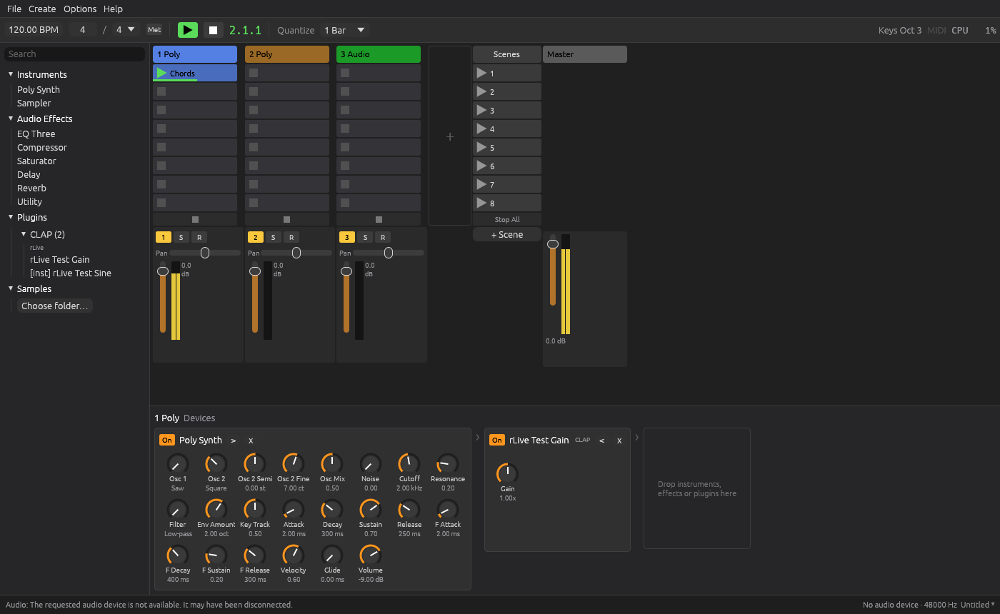

# rLive

A session-oriented DAW written in Rust, inspired by **Ableton Live** (clip launching, scenes)
and **Bitwig Studio** (modular device chains, crash-safe plugin hosting). macOS first; it also
builds and runs on Linux.



## Features

- **Session view**: tracks × scenes clip launcher with quantized launching (none … 4 bars),
  scene launch, stop buttons, playing/queued indicators and per-clip progress.
- **MIDI and audio clips**: looped or one-shot MIDI clips; audio clips from WAV, AIFF, FLAC, Ogg Vorbis, MP3 and M4A files (played at original speed, no time-stretching yet).
- **Clip view**: piano roll with bar ruler and draggable loop end, velocity lane, draw
  (double-click), move, resize, delete notes; grid snap (Alt = free), quantize,
  "Duplicate Loop", live playhead, clickable keyboard for previewing, Cmd+wheel zoom.
- **Mixer**: volume, pan, mute, solo, arm, stereo peak meters, master bus.
- **Device chains** (Bitwig-style horizontal cards) on every track and the master:
  - Built-in: **Poly Synth** (2 PolyBLEP oscillators, noise, ZDF filter with envelope, glide),
    **Sampler**, **EQ Three**, **Compressor**, **Saturator**, **Delay** (tempo-synced, ping-pong),
    **Reverb**, **Utility**.
  - Third-party plugins: **CLAP**, **VST3** and **Audio Units** (macOS) with parameters,
    state save/restore and native editor windows.
- **Out-of-process plugin scanning**: each plugin is scanned in a child process, so a broken
  plugin can't crash the DAW. Results are cached.
- **Browser** with search and drag & drop for devices, plugins and samples.
- **MIDI input** from hardware (routed lock-free straight to the audio thread) and an
  Ableton-style **computer keyboard** (A–K play notes, Z/X change octave).
- Metronome, tempo, time signature, `.rlive` project files (human-readable RON), WAV export.

## Building and running

Requires a recent stable Rust toolchain (1.85+).

```sh
cargo run --release            # start rLive
cargo run --release -- my.rlive  # open a project
./scripts/bundle-macos.sh      # build target/rLive.app (macOS)
```

On Linux you need ALSA headers: `sudo apt install libasound2-dev pkg-config`.

Plugins are found in the standard locations (`~/Library/Audio/Plug-Ins/{CLAP,VST3}`,
`/Library/Audio/Plug-Ins/...`, Audio Units via the system registry; `~/.clap`, `~/.vst3`,
`/usr/lib/{clap,vst3}` on Linux), plus `CLAP_PATH` / `VST3_PATH` and any folders added in
**Options → Audio, MIDI & Plugins**. Use **Options → Rescan Plugins** after installing new ones.

### Shortcuts

| Key | Action |
| --- | --- |
| Space | Play / stop |
| ⌘N / ⌘O / ⌘S / ⇧⌘S | New / open / save / save as |
| ⌘T / ⇧⌘T | New audio / MIDI track |
| ⌘D | Duplicate selected clip |
| Delete | Delete selected notes (piano roll) or clip |
| A W S E D F T G Y H U J K | Play notes on the armed (or selected) track |
| Z / X | Octave down / up |
| Shift+Tab | Switch Device / Clip view |
| ⌥⌘B / ⌥⌘L | Show/hide Browser / Detail View |
| ⌘+ / ⌘− | Zoom the whole UI in / out |

The layout follows Live: track headers, the clip-stop row, the mixer and the Master/scene
column stay in place while the clip grid scrolls (wheel, Shift+wheel for horizontal); track
widths and slot heights adapt to the window, and the mixer can be resized by dragging its top
edge. Hovering any control explains it in the Info View at the bottom left.

Clicking the triangle on a clip launches it; clicking the body selects it; double-clicking an
empty MIDI slot creates a clip. Drag clips between slots to move them (Alt to copy).

## Architecture

```
crates/
  rlive-core         shared types: musical time (960 PPQ), MIDI, parameters, the Processor trait
  rlive-engine       real-time engine: transport, clip launcher, device chains, mixer, metronome
  rlive-devices      built-in instruments/effects and DSP building blocks
  rlive-project      project model + .rlive (RON) file format
  rlive-plugin-host  CLAP, VST3 and AU hosting, out-of-process scanner
  rlive-app          egui UI, cpal audio output, midir MIDI input, session management
  rlive-test-clap    tiny CLAP plugins used by the hosting tests
  rlive-test-vst3    tiny VST3 plugin used by the hosting tests
```

**Real-time safety.** The UI thread owns the project. The audio thread owns the engine and
never allocates, locks or frees memory while processing:

- UI → audio: commands over a lock-free SPSC ring (`rtrb`). New tracks/devices are fully
  built and activated on the UI thread and sent as boxed nodes.
- Audio → UI: anything the engine releases (removed devices, replaced clips, whole sessions)
  is sent back on a "garbage" ring and dropped on the UI thread. Meters, playheads and clip
  states are published through atomics.
- Hardware MIDI uses its own ring so notes reach the audio thread without waiting for a UI frame.

**Plugins** are split into a main-thread `PluginHandle` (parameters, state, editor, plugin
callbacks) and a `Processor` living in the engine; both share the underlying instance.

## Credits

The UI font is [Inter](https://rsms.me/inter/) by Rasmus Andersson, licensed under the SIL Open
Font License 1.1 (`crates/rlive-app/assets/fonts/Inter-LICENSE.txt`). `rlive-test-vst3` is
adapted from the `vst3` crate's example (MIT/Apache-2.0).

## Testing

```sh
cargo test --workspace
```

The suite renders audio offline to check timing and DSP: sample-accurate quantized launches,
loop wrap note-offs, mute/solo/pan, every built-in device producing finite output, synth and
sampler pitch, and end-to-end hosting of real CLAP and VST3 binaries (built from the fixture
crates). On macOS it also instantiates Apple's built-in AUDelay. CI runs on macOS and Linux.

## Status and roadmap

This is an early but playable foundation. Not implemented yet:

- Audio recording, automation lanes, undo for knob and plugin parameter moves
- Time-stretching (audio clips play at original speed)
- Plugin delay compensation, sidechains, groups/return tracks, Bitwig-style modulators
- VST3 MIDI CC / pitch-bend mapping (`IMidiMapping`), AUv3-only view controllers
- Plugin editor windows on Linux/Windows (generic knob panels are always available)
